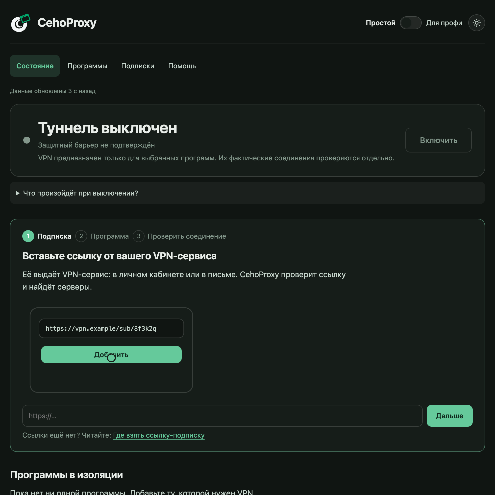
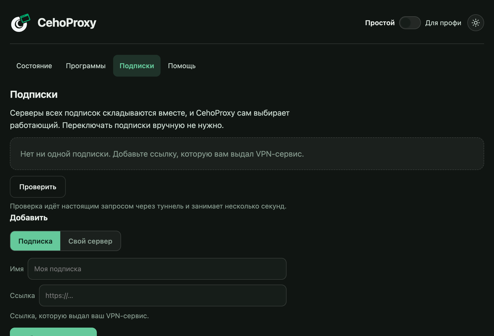

# Быстрый старт на компьютере

Пять шагов, около десяти минут. Подойдёт Windows, macOS и Linux.

## Что понадобится

- Подписка от вашего VPN-сервиса: одна ссылка. Где её взять, написано в [«Как добавить подписку»](03-add-subscription.md).
- Права администратора на время установки.

## Шаг 1. Установите

Скачайте установщик для вашей системы со [страницы выпусков](https://github.com/CodoCeh/CehoProxy/releases/latest) и запустите. Таблица файлов есть в [README](../../README.md#скачать).

Windows может написать «Windows защитила ваш компьютер». Установщик пока без цифровой подписи, потому что она платная. Нажмите «Подробнее», затем «Выполнить в любом случае».

Установщик сам скачает движок (программу, которая строит туннель). Делать для этого ничего не нужно.

## Шаг 2. Откройте панель

Панель открывается по адресу `http://127.0.0.1:8899` или командой `chp open`. В правом верхнем углу переключатель «Простой / Для профи»: оставьте «Простой».

Пока нет подписки, на «Состоянии» под статусом стоит мастер из трёх шагов с короткой анимацией на каждом. Те же четыре шага в картинках собраны на вкладке «Помощь», раздел «Как это выглядит».

## Шаг 3. Добавьте подписку

Откройте вкладку **Подписки**, вставьте ссылку в поле «Ссылка» и нажмите «Добавить подписку». CehoProxy сразу проверит её настоящим запросом через туннель, это занимает несколько секунд.

Все способы добавления (буфер обмена, QR-код, файл, свой сервер) описаны в [отдельной странице](03-add-subscription.md).

## Шаг 4. Выберите программы

Откройте вкладку **Программы**. Если CehoProxy нашла на компьютере программы, которым обычно нужен VPN, она предложит кнопку «Добавить все». Остальные программы добавляются из каталога или кнопкой «Выбрать программу». Подробности — в [«Программы и туннель»](04-apps-and-tunnel.md).

## Шаг 5. Включите

Вернитесь на **Состояние** и нажмите «Включить». Затем **перезапустите выбранные программы**: уже открытые программы продолжают старые соединения, а новые правила применяются только к новым.

Проверьте строку состояния наверху: там показаны реальный адрес и страна выхода. Если страна из вашей подписки, всё работает.

## Что дальше

- Хотите окно в оформлении Android-приложения? Откройте [CehoProxy Light](05-light.md).
- Что-то пошло не так? Откройте [«Если что-то не работает»](08-troubleshooting.md).
- Весь список команд терминала: `chp help`.
