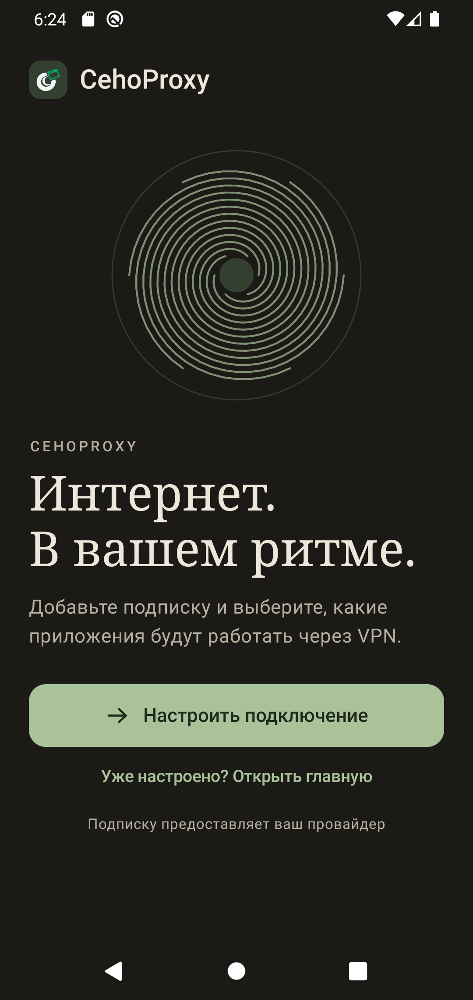
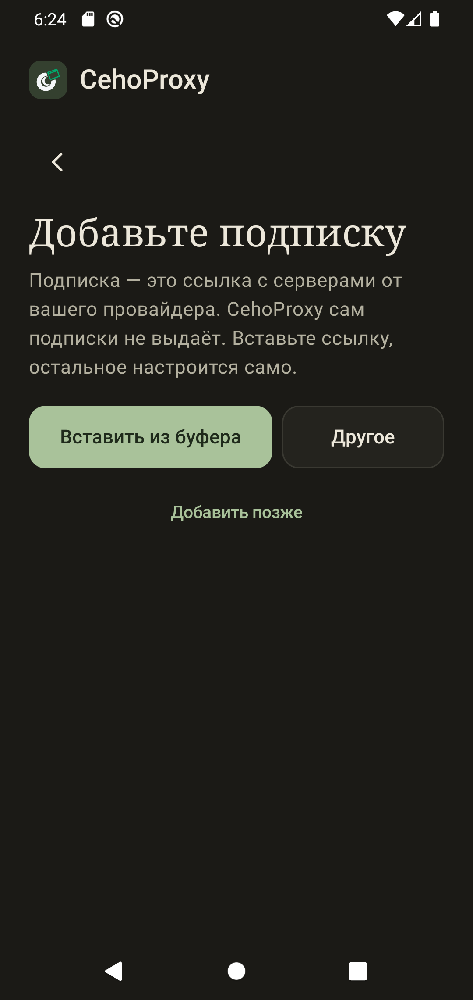
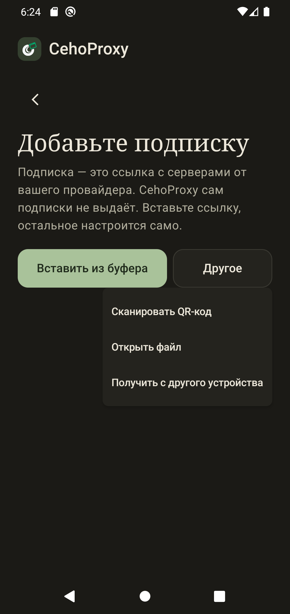
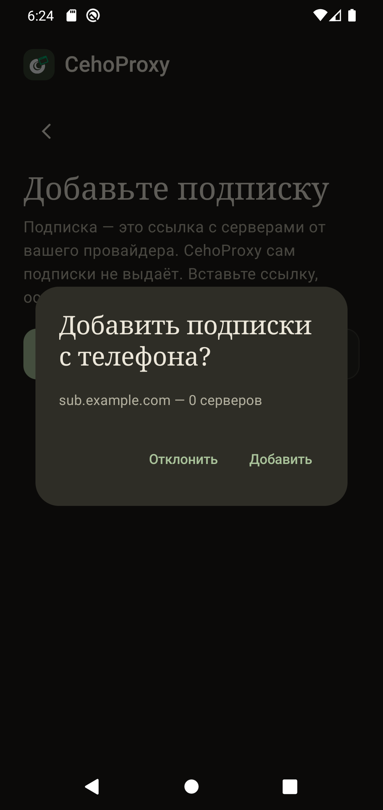

# Быстрый старт на Android

Подойдёт телефон, планшет и магнитола на Android 10 и новее. Root не нужен.

## Что понадобится

- Подписка от вашего VPN-сервиса: одна ссылка. Где её взять: [«Как добавить подписку»](03-add-subscription.md).
- Около пяти минут.

## Шаг 1. Установите

Скачайте APK со [страницы выпусков](https://github.com/CodoCeh/CehoProxy/releases) (файлы `cehoproxy-android-<версия>-<архитектура>.apk`). Для большинства современных телефонов подходит `arm64-v8a`. Android спросит разрешение на установку из этого источника: разрешите.

## Шаг 2. Первый экран

Нажмите **«Настроить подключение»**. Если приложение уже настроено, нажмите «Уже настроено? Открыть главную».

## Шаг 3. Добавьте подписку

Скопируйте ссылку подписки в любом приложении (мессенджере, почте, заметках), затем нажмите **«Вставить из буфера»**. Остальное настроится само: приложение скачает список серверов и проверит их.

Ссылки нет под рукой? Нажмите «Другое»:

| Способ | Что делать |
|---|---|
| Сканировать QR-код | Наведите камеру на QR-код, который показал провайдер или ваш компьютер. |
| Открыть файл | Выберите файл конфигурации `.json` или `.txt`. |
| Получить с другого устройства | Другой телефон или компьютер отправит подписку по Wi-Fi. |

«Добавить позже» пропускает шаг: подписку можно добавить в любой момент во вкладке «Подписки».

## Шаг 4. Подтвердите, если подписку прислали

Когда подписку отправляют с другого устройства, на экране появится вопрос. Проверьте имя и нажмите «Добавить». Пока вы не подтвердите, ничего не добавится.

## Шаг 5. Выберите приложения и включите

Выберите приложения, которые должны выходить через VPN, и включите туннель. Android один раз покажет запрос на создание VPN: согласитесь, иначе туннель не заработает.

## Если подписка не добавилась

- Проверьте, что ссылка скопирована целиком, без пробелов.
- Откройте ссылку в браузере телефона: должен открыться список серверов или длинный текст.
- Убедитесь, что есть интернет без VPN: подписка скачивается обычным путём.
- Не помогло: [«Если что-то не работает»](08-troubleshooting.md).

## Передать подписку на компьютер

В приложении откройте вкладку «Подписки», нажмите «Отправить на устройство» и выберите компьютер. Шаги подробно: [«Передача с другого устройства»](06-device-transfer.md).
