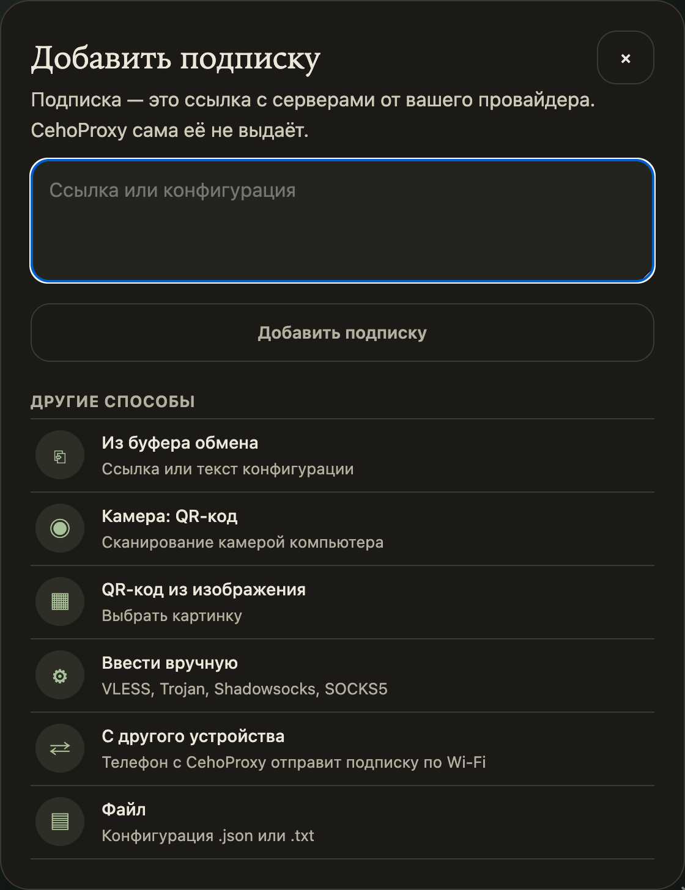

# Как добавить подписку

Подписка — это одна ссылка от вашего VPN-сервиса. По ней CehoProxy сама скачивает список серверов и обновляет его. Вписывать серверы вручную не нужно.

## Где взять ссылку

Ссылку выдаёт любой VPN-сервис, который разрешает сторонние программы. Ищите в личном кабинете или в боте сервиса пункт «Подписка», «Импорт» или «Добавить в клиент».

Подходит:

- обычная ссылка, которая открывает список серверов;
- файл настроек, сохранённый из другого VPN-клиента (`.json` или `.txt`);
- ссылка на один сервер: `vless://`, `vmess://`, `trojan://`, `ss://` и подобные;
- QR-код с любой из этих ссылок.

Своя подписка не нужна, если у вас есть собственный сервер: см. способ «Свой сервер» ниже.

## Способы на компьютере

### Веб-панель: вкладка «Подписки»

1. Откройте вкладку **Подписки**.
2. Вставьте ссылку в поле «Ссылка». Имя можно не заполнять.
3. Нажмите «Добавить подписку».

Для собственного сервера выберите вкладку «Свой сервер» рядом с «Подпиской». Понадобятся его адрес, логин и пароль.

### Окно CehoProxy Light: кнопка «+»

В [Light](05-light.md) в шапке стоит кнопка «+». Она открывает окно со всеми способами.



| Способ | Что делать |
|---|---|
| Поле «Ссылка или конфигурация» | Вставьте ссылку или текст настроек и нажмите «Добавить подписку». |
| Из буфера обмена | Скопируйте ссылку в любой программе. CehoProxy прочитает её одним нажатием. |
| Камера: QR-код | Наведите камеру компьютера на QR-код. Браузер спросит разрешение на камеру. |
| QR-код из изображения | Выберите картинку со скриншотом QR-кода. |
| Ввести вручную | Выберите протокол (VLESS, Trojan, Shadowsocks, SOCKS5) и заполните адрес, порт и данные доступа. |
| С другого устройства | Телефон с CehoProxy отправит подписку по Wi-Fi. См. [«Передача с другого устройства»](06-device-transfer.md). |
| Файл | Выберите конфигурацию `.json` или `.txt`. |

### Терминал

```bash
chp sub-add
```

Команда спросит ссылку и сразу проверит подписку.

## Способы на Android

Откройте приложение, нажмите «Добавить подписку» и выберите способ: ссылка, буфер обмена, сканирование QR-кода, файл или «Получить с другого устройства». Пошаговый рассказ — в [«Быстром старте на Android»](02-android-start.md).

## Как понять, что подписка добавилась

- Подписка появилась в списке, рядом число серверов.
- Статус «работает». Если там ошибка, ссылка скорее всего устарела или скопирована не целиком: возьмите новую у провайдера.
- После включения туннеля в строке состояния видна страна выхода.

## Если ссылка не принимается

- Скопируйте ссылку целиком, без пробелов и переносов в начале и в конце.
- Откройте ссылку в браузере: если там список серверов или длинный текст, ссылка рабочая.
- Некоторые провайдеры привязывают ссылку к устройству. Тогда её нужно получить заново в личном кабинете.
- Не помогло: [«Если что-то не работает»](08-troubleshooting.md).
