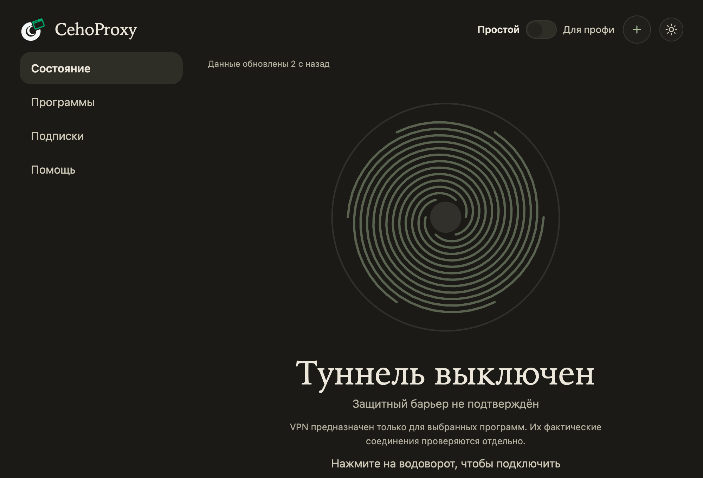

# CehoProxy Light

Light — окно CehoProxy в оформлении Android-приложения: крупный водоворот, статус, скорость, кнопка «+» для подписок. Это тот же CehoProxy, что и веб-панель: те же настройки, те же команды. Что изменили в одном окне, видно в другом.

## Как открыть

| Система | Как |
|---|---|
| Windows | Значок CehoProxy в области уведомлений: двойной щелчок, либо правой кнопкой «Открыть CehoProxy Light». |
| macOS | Значок в строке меню: пункт «Открыть CehoProxy Light». Есть начиная с версии 1.2.182. |
| Linux | Значок в трее: «Открыть CehoProxy Light». |
| Любая | В браузере по адресу `http://127.0.0.1:8899/light`. |

Если порт панели у вас другой, его покажет `chp status`. Если пункта «Открыть CehoProxy Light» в меню нет, у вас версия старше 1.2.182: обновите программу.

Закрытие окна не выключает VPN. Окно прячется, значок остаётся.

## Водоворот — это кнопка

Нажмите на водоворот, чтобы включить туннель. Нажмите ещё раз, чтобы выключить. Когда туннель включён, программы из вашего списка по очереди влетают в водоворот: так видно, какие программы сейчас под защитой.

Под водоворотом написано, что он сделает при нажатии.

## Кнопка «+»

В шапке стоит кнопка «+». Она открывает окно «Добавить подписку» со всеми способами: ссылка, буфер обмена, камера, QR-код из картинки, ручной ввод, файл и «С другого устройства». Подробно: [«Как добавить подписку»](03-add-subscription.md).

## Разделы

Слева (в узком окне внизу) расположены те же разделы, что и в веб-панели: Состояние, Программы, Подписки, Помощь. В режиме «Для профи» добавляются остальные.

## Свет и тема

Светлая или тёмная тема берётся из настроек системы. Если в системе включено «Уменьшить движение», водоворот не вращается.

## Если окно не открывается

- Убедитесь, что служба CehoProxy работает: `chp status`.
- Откройте адрес `http://127.0.0.1:8899/light` в браузере. Если он открывается, проблема только в окне: перезапустите значок в трее.
- На Linux окну нужна библиотека `libwebkit2gtk-4.1`. Если её нет, CehoProxy открывает Light в браузере в режиме приложения.
