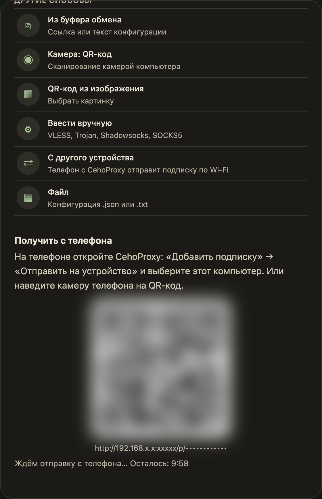

# Передача подписки с другого устройства

Подписка уже есть на телефоне? Не нужно искать ссылку заново: телефон отправит её на компьютер по домашней сети Wi-Fi.

## Что нужно

- Телефон и компьютер подключены к одной домашней сети (Wi-Fi или кабель).
- На компьютере открыт [CehoProxy Light](05-light.md).
- На телефоне стоит приложение CehoProxy с добавленной подпиской.

## Шаги

1. На компьютере в Light нажмите «+» и выберите **«С другого устройства»**.
2. Появится QR-код и адрес. Окно ждёт 10 минут.
3. На телефоне откройте CehoProxy, откройте вкладку «Подписки» и нажмите «Отправить на устройство». Выберите свой компьютер из списка. Если компьютер не показан, наведите камеру телефона на QR-код.
   Камера откроет в браузере страницу с двумя вариантами: кнопка «Открыть в CehoProxy» (если приложение есть на телефоне) и поле, куда можно вставить ссылку на подписку. Второй способ работает на любом телефоне, в том числе на iPhone, где приложения нет.
4. На компьютере появится список того, что прислал телефон. Проверьте его и нажмите **«Добавить»**.

Ничего не добавится без вашего нажатия на компьютере.

## Как это защищено

- Порт для приёма открывается только на 10 минут и только в вашей домашней сети. Через интернет он недоступен.
- Адрес содержит случайный секрет. Без него отправить ничего нельзя.
- Принимается одна отправка размером до 1 МБ. После неё порт закрывается.
- Кнопка «Отмена» или закрытие окна закрывают порт сразу.
- На Windows CehoProxy добавляет правило брандмауэра «CehoProxy receive»: оно пускает только устройства вашей локальной сети.

## Если не получается

- **«Компьютер не подключён к домашней сети»**: подключите компьютер к тому же Wi-Fi, что и телефон.
- **Телефон не видит компьютер в списке**: наведите камеру на QR-код или вручную откройте на телефоне адрес из окна.
- **Время вышло**: откройте окно «С другого устройства» снова.
- **Гостевой Wi-Fi**: у многих роутеров гостевая сеть запрещает устройствам видеть друг друга. Используйте основную сеть.
